# Se Caissa Analytics — Documentación del Dominio

> Sistema de medición del rendimiento deportivo en ajedrez para la toma de decisiones del entrenador.  
> **Periodo:** 2026–2027 | **Arquitectura:** Hexagonal (Ports & Adapters) | **Capa:** Dominio Puro

---

## Tabla de Contenidos

- [1. Visión General](#1-visión-general)
- [2. Arquitectura Hexagonal](#2-arquitectura-hexagonal)
- [3. Estructura de Carpetas](#3-estructura-de-carpetas)
- [4. Convenciones Transversales](#4-convenciones-transversales)
- [5. Módulos del Dominio](#5-módulos-del-dominio)
  - [5.1 Usuarios y Permisos — RF-01](#51-usuarios-y-permisos--rf-01)
  - [5.2 Atletas — RF-02](#52-atletas--rf-02)
  - [5.3 Objetivos SMART — RF-03](#53-objetivos-smart--rf-03)
  - [5.4 Entrenamientos — RF-04](#54-entrenamientos--rf-04)
  - [5.5 Partidas y Análisis Técnico — RF-05 / RF-07](#55-partidas-y-análisis-técnico--rf-05--rf-07)
  - [5.6 Patrones de Error — RF-06](#56-patrones-de-error--rf-06)
  - [5.7 Repertorio de Aperturas — RF-08](#57-repertorio-de-aperturas--rf-08)
  - [5.8 Indicadores, Dashboards e Informes — RF-09 / RF-11](#58-indicadores-dashboards-e-informes--rf-09--rf-11)
  - [5.9 Evaluación del Entrenador — RF-10](#59-evaluación-del-entrenador--rf-10)
  - [5.10 Auditoría y Control de Cambios — RF-12](#510-auditoría-y-control-de-cambios--rf-12)
- [6. Diagrama de Clases Global](#6-diagrama-de-clases-global)
- [7. Dependencias entre Módulos](#7-dependencias-entre-módulos)
- [8. Flujo Típico de Uso](#8-flujo-típico-de-uso)
- [9. Cómo Extender el Dominio](#9-cómo-extender-el-dominio)
- [10. Validación](#10-validación)
- [11. Adaptadores Pendientes](#11-adaptadores-pendientes)

---

## 1. Visión General

La carpeta `dominio/` es el **núcleo de negocio** de Se Caissa Analytics. Contiene toda la lógica de la aplicación sin depender de tecnología concreta:

- **No conoce** bases de datos, frameworks web, APIs externas, autenticación concreta (JWT, OAuth) ni generadores de PDF/Excel.
- **No sabe** nada de `FastAPI`, `SQLAlchemy`, `Stockfish`, `Chess.com` o `Lichess`.

Esa separación es la base de la **arquitectura hexagonal** (puertos y adaptadores): el dominio define *qué* debe hacer el sistema (reglas de negocio) y los adaptadores definen *cómo* se hace en la práctica (persistencia, web, archivos).

---

## 2. Arquitectura Hexagonal

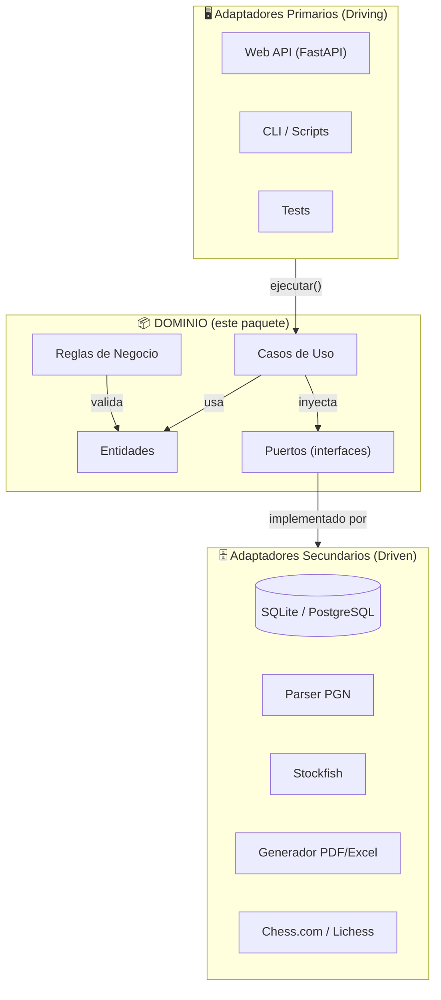

### Principios aplicados

| Principio | Descripción |
|---|---|
| **Independencia tecnológica** | El dominio no importa librerías externas de infraestructura. |
| **Inversión de dependencias** | Los casos de uso dependen de abstracciones (puertos), no de implementaciones. |
| **Inmutabilidad selectiva** | Entidades críticas (`RegistroAuditoria`, `PerfilHistorico`) son inmutables. |
| **Referencias por ID** | Los módulos se referencian mediante identificadores, nunca por instancias completas. |
| **Consulta cruzada por puertos** | Cuando un módulo necesita datos de otro, define su propio puerto que los adaptadores implementarán. |

---

## 3. Estructura de Carpetas

```text
dominio/
├── __init__.py              # Docstring del paquete
├── comun/                   # Utilidades compartidas
│   ├── errores.py           # Excepciones de dominio
│   ├── constantes.py        # Límites operativos
│   ├── reglas_limites.py    # Validaciones compartidas
│   └── ids.py               # Generación de IDs
├── usuarios/                # RF-01
│   ├── entidades.py
│   ├── puertos.py
│   └── casos_de_uso.py
├── atletas/                 # RF-02
├── objetivos/               # RF-03
├── entrenamientos/          # RF-04
├── partidas/                # RF-05, RF-07
├── patrones/                # RF-06
├── aperturas/               # RF-08
├── indicadores/             # RF-09, RF-11
├── evaluaciones/            # RF-10
└── auditoria/               # RF-12
```

Cada módulo sigue el patrón de tres archivos:

| Archivo | Responsabilidad |
|---|---|
| `entidades.py` | Datos + invariantes (validaciones, cálculos, estados). |
| `puertos.py` | **Puertos secundarios (driven)**: interfaces abstractas (`ABC`). |
| `casos_de_uso.py` | **Puertos primarios (driving)**: orquestación del flujo de negocio. |

---

## 4. Convenciones Transversales

### 4.1 Errores de Dominio

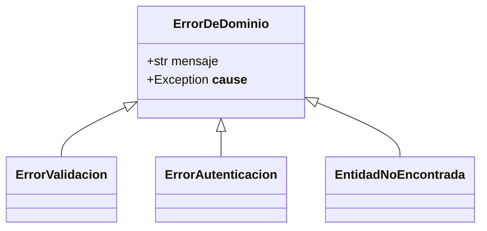

| Excepción | Cuándo ocurre |
|---|---|
| `ErrorDeDominio` | Base de todas las demás. |
| `ErrorValidacion` | Violación de una regla de negocio o validación. |
| `ErrorAutenticacion` | Credenciales o autorización incorrectas. |
| `EntidadNoEncontrada` | Se busca una entidad que no existe. |

### 4.2 Constantes y Reglas Compartidas

- **`constantes.py`** — límites operativos: máximo **40 atletas por entrenador** (RF-01.8) y **1 a 3 entrenadores por atleta** (RF-02.6).
- **`reglas_limites.py`** — funciones puras: `validar_capacidad_entrenador(cantidad)` y `validar_entrenadores_por_atleta(cantidad)`.
- **`ids.py`** — `nuevo_id(prefijo="")` genera UUIDs opcionalmente prefijados (ej. `objetivo_xxxxxxxx-...`).

### 4.3 Entidades

- Son `@dataclass` de Python.
- Las entidades de un módulo **referencian a otras por `id`**, nunca por objeto completo.
- Las entidades inmutables se marcan `@dataclass(frozen=True)`.

### 4.4 Puertos

- Interfaces con métodos `@abstractmethod`, declaradas sobre `ABC`.
- Nombres orientados al **qué**, no al **cómo**.

### 4.5 Casos de Uso

- `@dataclass` con dependencias inyectadas **por constructor**.
- Punto de entrada único: `ejecutar(...)`.
- **Nunca instancian adaptadores**.

---

## 5. Módulos del Dominio

---

### 5.1 Usuarios y Permisos — RF-01

**Responsabilidad:** gestionar identidad, roles y permisos del sistema.

#### Entidades

| Clase | Atributos principales |
|---|---|
| `Usuario` | `id`, `correo`, `hash_contrasena`, `rol`, `fecha_creacion` |
| `Rol` | `ENTRENADOR`, `ATLETA`, `INVITADO` |
| `Permiso` | Conjunto de acciones permitidas por rol |

#### Puertos

| Puerto | Tipo | Descripción |
|---|---|---|
| `RepositorioUsuarios` | Secundario | CRUD y búsquedas de usuarios. |
| `ServicioHashContrasenas` | Secundario | Abstrae bcrypt/argon2. |
| `PermisosPorRol` | Secundario | Matriz rol → permisos. |

#### Casos de Uso

| Caso de Uso | Actor | Descripción |
|---|---|---|
| `AutenticarUsuario` | Sistema | Valida credenciales y devuelve sesión/token. |
| `CrearUsuario` | Entrenador | Registra un nuevo usuario con rol asignado. |
| `VerificarPermiso` | Sistema | Valida si un usuario puede ejecutar una acción. |
| `ObtenerUsuarioActual` | Cualquiera | Recupera el perfil del usuario autenticado. |

#### Diagrama de Clases

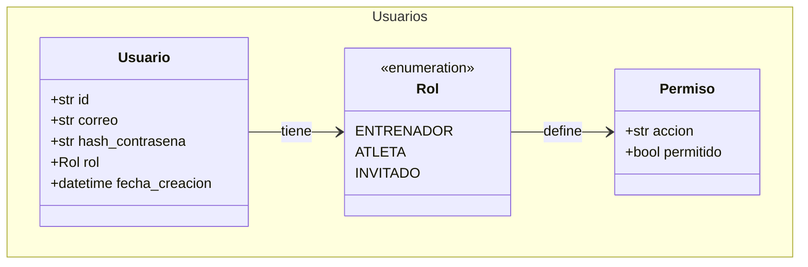

#### Reglas de Negocio Clave

- Solo puede existir **un único usuario ENTRENADOR** como administrador (RF-01.3).
- Correo con formato válido y contraseña de al menos 8 caracteres.
- Un entrenador tiene máximo 40 atletas; un atleta tiene entre 1 y 3 entrenadores.

---

### 5.2 Atletas — RF-02

**Responsabilidad:** expediente deportivo integral del ajedrecista.

#### Entidades

| Clase | Atributos principales |
|---|---|
| `Atleta` | `id`, `nombre`, `fecha_nacimiento`, `sexo`, `identidad_opcional`, `fotografia_opcional`, `federacion`, `universidad`, `carrera`, `categorias[]`, `clubs[]`, `entrenadores_asignados[]` |
| `Rating` | `clasicas`, `rapidas`, `blitz`, `chess_com`, `lichess`, `fecha_actualizacion` |
| `Categoria` | `nombre`, `tipo` (EDAD/NIVEL/ELO), `rango`, `editable_por_admin` |
| `PerfilHistorico` | Snapshot inmutable por año/torneo |

#### Puertos

| Puerto | Tipo | Descripción |
|---|---|---|
| `RepositorioAtletas` | Secundario | Persistencia del expediente deportivo. |
| `RepositorioCategorias` | Secundario | Gestión de categorías configurables (RNF-07.1). |

#### Casos de Uso

| Caso de Uso | Actor | Descripción |
|---|---|---|
| `RegistrarAtleta` | Entrenador | Crea perfil con validaciones de campos obligatorios. |
| `ActualizarPerfilAtleta` | Entrenador | Modifica datos personales y deportivos. |
| `ConsultarPerfilAtleta` | Entrenador/Atleta | Devuelve expediente completo con edad calculada. |
| `AsignarCategoriaAAtleta` | Entrenador | Vincula una o varias categorías. |
| `AsignarEntrenadorAAtleta` | Entrenador | Valida límites mínimos y máximos. |
| `ActualizarRating` | Entrenador/Sistema | Modifica ratings y genera snapshot histórico. |
| `ListarAtletasPorEntrenador` | Entrenador | Devuelve todos los atletas asignados. |

#### Diagrama de Clases

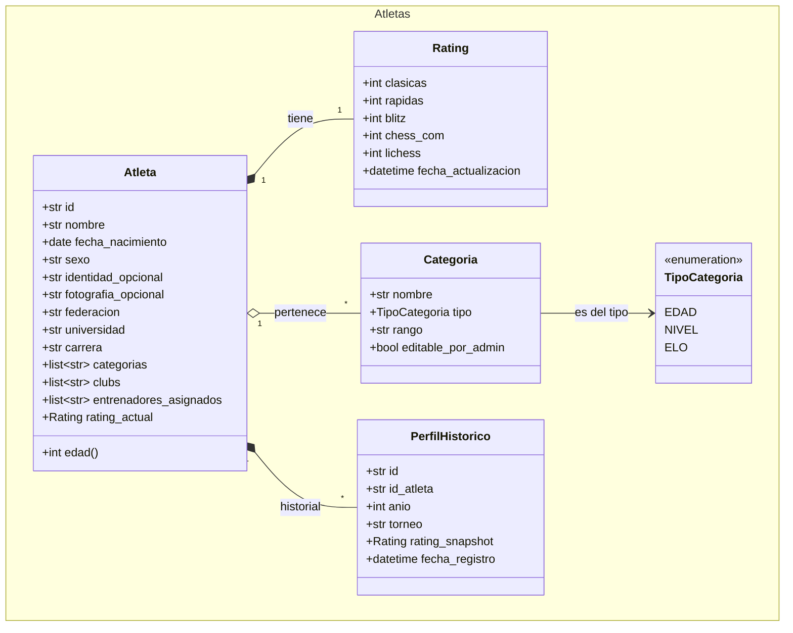

#### Reglas de Negocio Clave

- La **edad se calcula automáticamente** a partir de la fecha de nacimiento.
- Un atleta puede pertenecer a **múltiples categorías** y **múltiples clubs**.
- El historial por año/torneo es **inmutable** desde el dominio.
- Ratings FIDE (clásicas, rápidas, blitz), Chess.com y Lichess son **obligatorios**.

---

### 5.3 Objetivos SMART — RF-03

**Responsabilidad:** definir, seguir y validar objetivos cuantificables de rendimiento.

#### Entidades

| Clase | Atributos principales |
|---|---|
| `ObjetivoSmart` | `id_atleta`, `descripcion`, `indicador_meta`, `valor_meta`, `rating_actual`, `rating_meta`, `fecha_inicio`, `fecha_limite`, `porcentaje_avance`, `estado`, `aprobado_por_entrenador` |
| `IndicadorAvance` | `tipo`, `valor_actual`, `valor_esperado` |
| `EstadoObjetivo` | `PENDIENTE_APROBACION`, `EN_PROCESO`, `RETRASADO`, `FINALIZADO` |
| `TipoIndicadorAvance` | `HORAS_ENTRENADAS`, `RATING`, `TAREAS`, `TORNEOS`, `MEDALLAS` |

#### Puertos

| Puerto | Tipo | Descripción |
|---|---|---|
| `RepositorioObjetivos` | Secundario | Persistencia de objetivos. |
| `ProveedorDatosAvance` | Secundario | **Consulta cruzada**: obtiene horas/rating/torneos actuales sin acoplar a otros repositorios. |

#### Casos de Uso

| Caso de Uso | Actor | Descripción |
|---|---|---|
| `CrearObjetivoSmart` | Entrenador/Atleta | Propone objetivo; queda pendiente de aprobación. |
| `AprobarObjetivoSmart` | Entrenador | Valida y activa el objetivo. |
| `CalcularAvanceObjetivo` | Sistema | Computa porcentaje automáticamente. |
| `EvaluarEstadoObjetivo` | Sistema | Determina semáforo: EN_PROCESO, RETRASADO, FINALIZADO. |
| `ValidarCumplimientoObjetivo` | Entrenador | Confirma que se alcanzó el indicador. |
| `ListarObjetivosPorAtleta` | Entrenador/Atleta | Filtra por estado, fechas y tipo. |

#### Diagrama de Clases

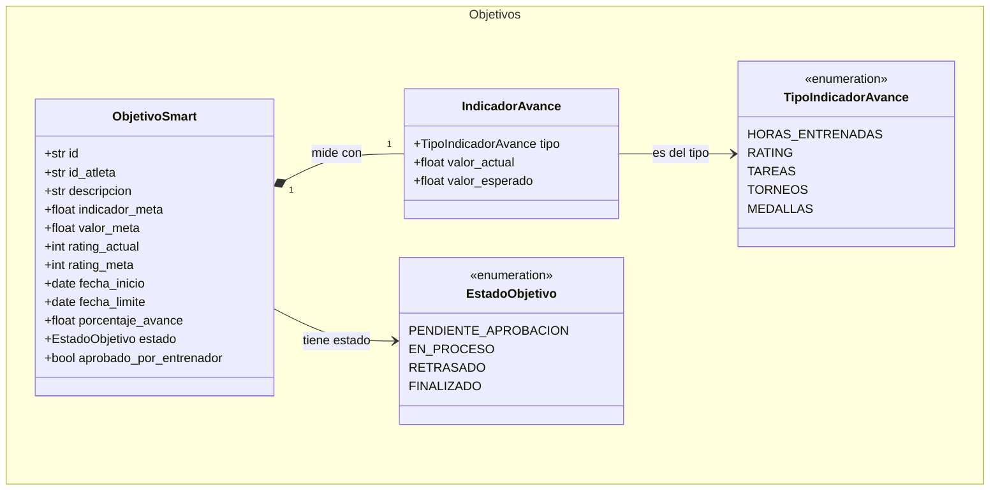

#### Reglas de Negocio Clave

- Todo objetivo debe tener **fecha de inicio y límite obligatorias**.
- **RETRASADO** = porcentaje real < porcentaje esperado respecto a la fecha límite.
- El semáforo es: 🟢 verde (finalizado), 🟡 amarillo (en proceso), 🔴 rojo (retrasado).
- **Solo el entrenador** puede marcar un objetivo como cumplido.

---

### 5.4 Entrenamientos — RF-04

**Responsabilidad:** planificación semanal, registro de ejecución y control de asistencia.

#### Entidades

| Clase | Atributos principales |
|---|---|
| `PlanEntrenamientoSemanal` | `semana`, `anio`, `sesiones[]`, `total_horas_planificadas` |
| `SesionEntrenamiento` | `tipo`, `dia_semana`, `horas_planificadas`, `estado`, `observaciones` |
| `EjecucionEntrenamiento` | `id_sesion`, `horas_ejecutadas`, `fecha_registro`, `registrado_por_atleta`, `aprobado_por_entrenador` |
| `Asistencia` | `id_atleta`, `id_sesion`, `fecha`, `estado` (PRESENTE/AUSENTE/JUSTIFICADO) |
| `ResumenCumplimientoSemanal` | Value Object: planificado vs ejecutado y porcentaje |

#### Puertos

| Puerto | Tipo | Descripción |
|---|---|---|
| `RepositorioEntrenamientos` | Secundario | Planes, sesiones y ejecuciones. |
| `RepositorioAsistencia` | Secundario | Registro y consulta de asistencias. |

#### Casos de Uso

| Caso de Uso | Actor | Descripción |
|---|---|---|
| `PlanificarEntrenamientoSemanal` | Entrenador | Define horas y tipos antes del inicio de la semana. |
| `ReprogramarSesion` | Entrenador | Cambia fecha/hora de una sesión. |
| `RegistrarEjecucionEntrenamiento` | Atleta | Reporta horas ejecutadas por sesión. |
| `AprobarHorasEjecutadas` | Entrenador | Valida las horas reportadas. |
| `ConsultarCumplimientoSemanal` | Entrenador/Atleta | Contrasta planificado vs ejecutado. |
| `RegistrarAsistencia` | Entrenador | Marca asistencia post-sesión. |
| `ConsultarHistorialEntrenamientos` | Entrenador/Atleta | Recupera semanas anteriores. |

#### Diagrama de Clases

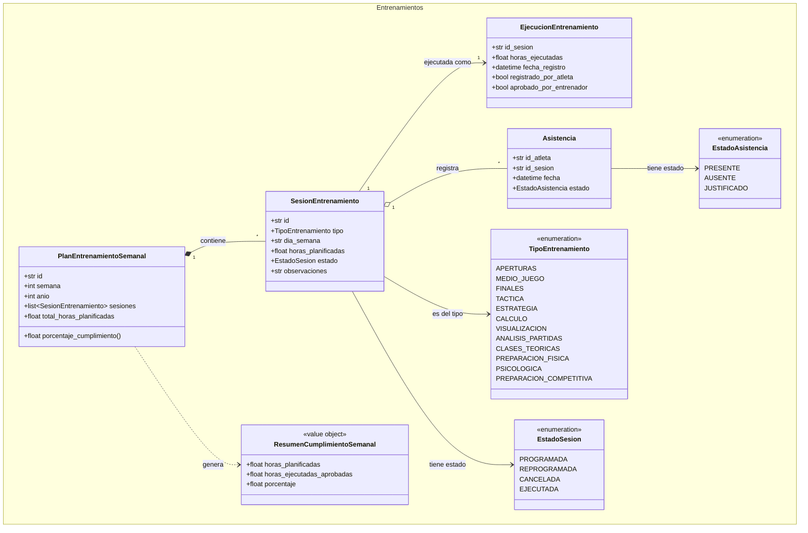

#### Reglas de Negocio Clave

- La visualización de detalle es **siempre por semana**, no por día.
- Una sesión cancelada o reprogramada **conserva el historial original**.
- **% de cumplimiento** = horas ejecutadas aprobadas / horas planificadas × 100.

---

### 5.5 Partidas y Análisis Técnico — RF-05 / RF-07

**Responsabilidad:** registrar competencias, almacenar resúmenes de análisis y clasificar la calidad del juego.

#### Entidades

| Clase | Atributos principales |
|---|---|
| `Partida` | `evento`, `fecha`, `jugador_blancas`, `jugador_negras`, `rating_blancas`, `rating_negras`, `resultado`, `apertura_eco`, `control_tiempo`, `color_atleta` |
| `AnalisisTecnico` | `accuracy`, `acpl`, `blunders`, `errores`, `imprecisiones`, `brilliant_moves`, `excelente`, `buena`, `libro`, `tiempo_promedio_jugada`, `perdidas_tiempo` |
| `ClasificacionPartida` | `PARTIDA_BOTADA`, `EXCELENTE`, `BUENA`, `LIBRO` |
| `EstadisticasFaseJuego` | `apertura` (éxito, errores, tiempo), `medio_juego` (precisión, errores tácticos/estratégicos), `finales` (conversión, tablas, errores técnicos) |

#### Puertos

| Puerto | Tipo | Descripción |
|---|---|---|
| `RepositorioPartidas` | Secundario | Persistencia de partidas. |
| `RepositorioAnalisisTecnico` | Secundario | Resúmenes técnicos post-partida. |
| `ProveedorPGN` | Secundario | El dominio no parsea PGN; solicita la partida ya estructurada. |

#### Casos de Uso

| Caso de Uso | Actor | Descripción |
|---|---|---|
| `RegistrarPartida` | Entrenador | Crea registro con datos obligatorios. |
| `RegistrarAnalisisTecnico` | Entrenador | Completa resumen técnico post-partida. |
| `ClasificarPartida` | Sistema | Asigna categoría según reglas del dominio. |
| `ConsultarEstadisticasPorFase` | Entrenador/Atleta | Agrega métricas por fase del juego. |
| `ImportarPartidaDesdePGN` | Entrenador | Orquesta lectura del proveedor PGN y registro. |

#### Diagrama de Clases

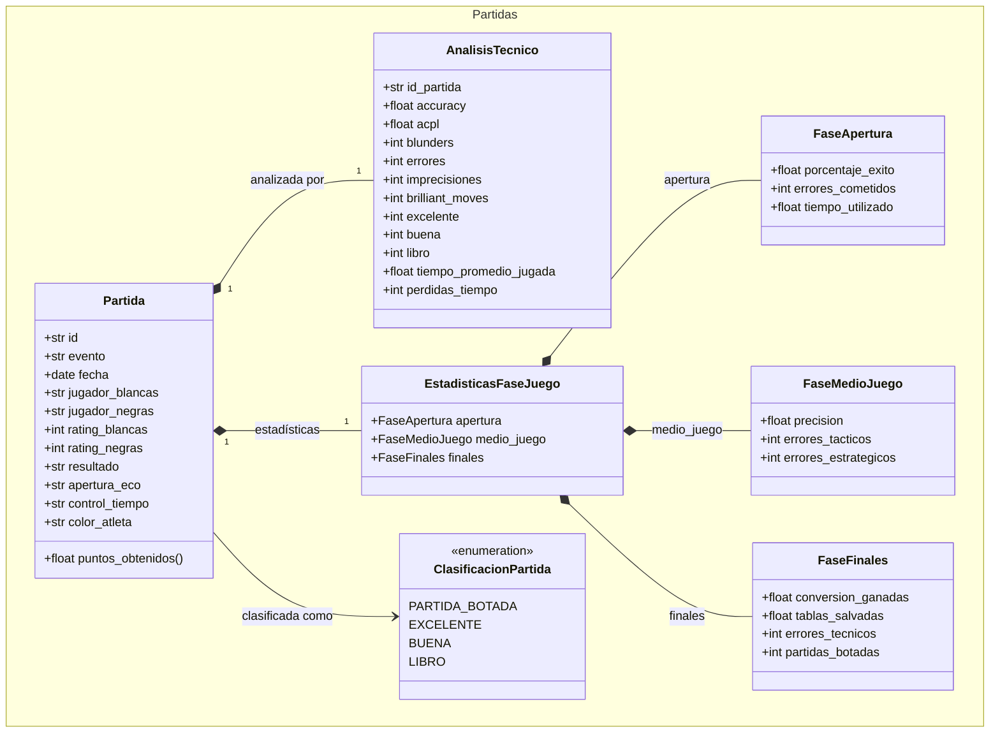

#### Reglas de Negocio Clave

- Solo se almacenan **resúmenes** del análisis, no movimiento a movimiento.
- **Partida botada** = ventaja > +3 con pérdida/empate por blunder.
- **Excelente** = accuracy ≥ 85 sin blunders.
- **Libro** evalúa conocimiento de apertura, no calidad global del jugador.
- Los puntos y la clasificación respetan el **color con el que jugó el atleta**.

---

### 5.6 Patrones de Error — RF-06

**Responsabilidad:** detectar patrones recurrentes sin generar sugerencias (solo estadísticas).

#### Entidades

| Clase | Atributos principales |
|---|---|
| `PatronDetectado` | `tipo`, `descripcion`, `frecuencia_absoluta`, `frecuencia_relativa`, `partidas_afectadas[]`, `nivel_confianza` |
| `AnalisisPatrones` | `id_atleta`, `periodo`, `patrones[]`, `total_partidas_analizadas` |
| `TipoPatron` | `TACTICO`, `ESTRATEGICO`, `APERTURA`, `FINALES`, `GESTION_TIEMPO`, `COMPETITIVO`, `DISCIPLINA` |
| `NivelMinimoPartidas` | `BASICO` (5), `INICIAL` (10), `APERTURA` (15), `FINALES` (15), `COLOR` (20), `RIVAL` (20), `AVANZADO` (30) |

#### Puertos

| Puerto | Tipo | Descripción |
|---|---|---|
| `ProveedorDatosPartidas` | Secundario | Partidas con análisis + conteos de disciplina. |

#### Casos de Uso

| Caso de Uso | Actor | Descripción |
|---|---|---|
| `DetectarPatronesError` | Sistema | Analiza partidas y entrenamientos para identificar patrones. |

#### Diagrama de Clases

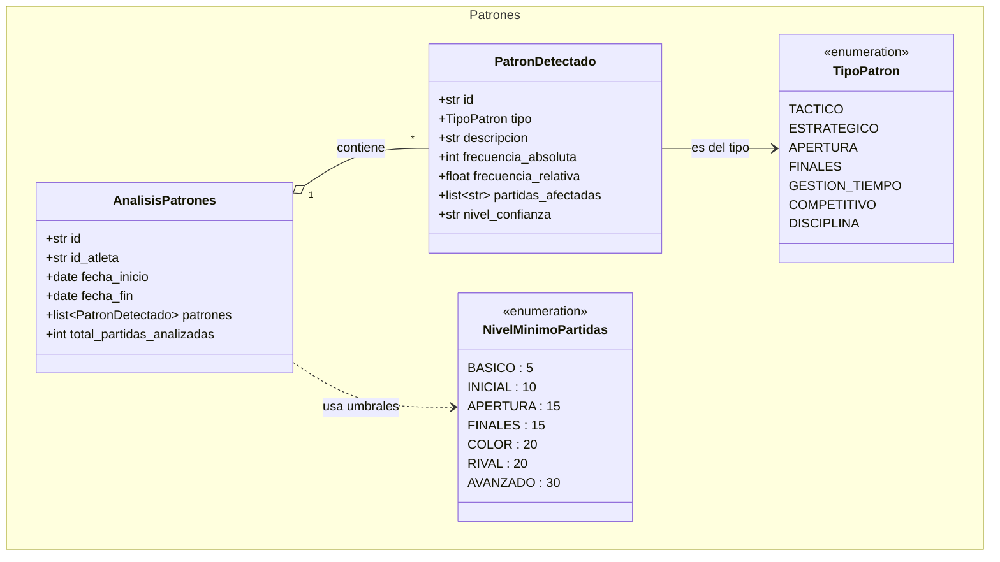

#### Reglas de Negocio Clave

- Un comportamiento es patrón si se repite en **≥ 5 partidas o en > 40 %** de las analizadas (RF-06.8).
- Detecta: blunders, piezas colgadas, mala estructura de peones, salidas tempranas de teoría, apuros de tiempo, incumplimiento del plan, baja asistencia, rendimiento por color y contra rivales de mayor rating.
- **No genera sugerencias automáticas** (RF-06.10).

---

### 5.7 Repertorio de Aperturas — RF-08

**Responsabilidad:** gestionar el repertorio del atleta con estadísticas de efectividad.

#### Entidades

| Clase | Atributos principales |
|---|---|
| `AperturaRepertorio` | `id_atleta`, `codigo_eco`, `nombre`, `variante`, `color`, `estado`, `nivel_dominio`, `fuente_estudio`, `observaciones`, `clasificacion_uso` |
| `EstadisticaApertura` | `partidas_jugadas`, `victorias`, `empates`, `derrotas`, `accuracy_promedio`, `acpl_promedio`, `errores_frecuentes` |
| `EstadisticaAperturaPorTorneo` | Filtrado por año, control de tiempo, color, nivel de rival y rival específico |

#### Puertos

| Puerto | Tipo | Descripción |
|---|---|---|
| `RepositorioAperturas` | Secundario | Persistencia del repertorio. |
| `ProveedorEvaluacionMotor` | Secundario | Evaluación numérica de posiciones (ej. Stockfish). |

#### Casos de Uso

| Caso de Uso | Actor | Descripción |
|---|---|---|
| `RegistrarAperturaRepertorio` | Entrenador | Añade una apertura al repertorio del atleta. |
| `ClasificarAperturaPrincipalSecundaria` | Entrenador | Define si es línea principal u ocasional. |
| `EvaluarEfectividadApertura` | Sistema | Calcula nivel: MUY_EFECTIVA, EFECTIVA, EN_DESARROLLO, REQUIERE_REVISION. |
| `ConsultarEstadisticasGeneralesApertura` | Entrenador/Atleta | Resultados, accuracy y ACPL. |
| `ConsultarEstadisticasPorTorneo` | Entrenador/Atleta | Filtra por contexto competitivo. |

#### Diagrama de Clases

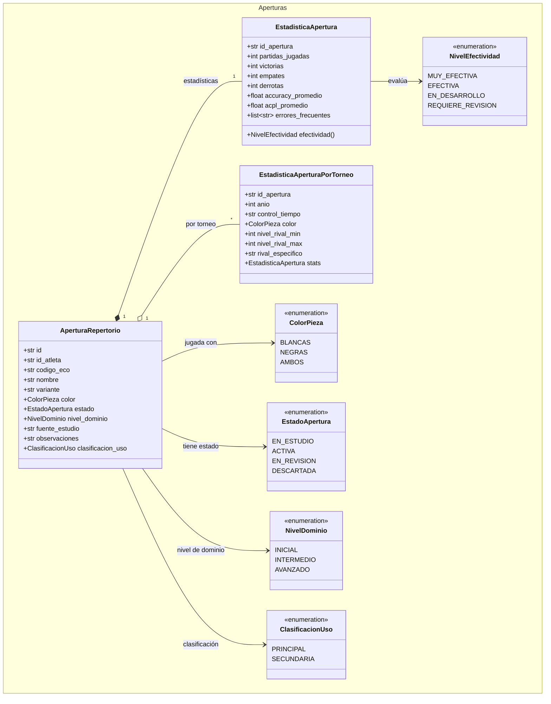

#### Reglas de Negocio Clave

- Una misma apertura puede existir para **blancas y negras independientemente**.
- La efectividad se mide por el **desempeño del atleta**, no por la valoración teórica de la apertura.

---

### 5.8 Indicadores, Dashboards e Informes — RF-09 / RF-11

**Responsabilidad:** calcular métricas de rendimiento, generar vistas consolidadas y exportar reportes.

#### Entidades

| Clase | Atributos principales |
|---|---|
| `IndicadorRendimiento` | `tipo` (15 tipos), `valor`, `rango_evaluacion`, `periodo` |
| `RangoEvaluacion` | `EXCELENTE`, `BUENO`, `ACEPTABLE`, `REQUIERE_INTERVENCION` |
| `Alerta` | `tipo`, `id_atleta`, `fecha_generacion`, `estado` |
| `DashboardEntrenador` | `resumen_equipo`, `atletas_activos`, `alertas[]`, `cumplimiento_plan`, `evolucion_rating_grupal`, `objetivos_pendientes` |
| `DashboardAtleta` | `kpi_personales[]`, `semaforos`, `comparacion_mes_actual_vs_anterior` |
| `Reporte` | `tipo` (INDIVIDUAL/GRUPAL/INSTITUCIONAL), `formato` (PDF/Excel), `contenido` |
| `TendenciaComparada` | `variacion_absoluta`, `variacion_porcentual` |

#### Puertos

| Puerto | Tipo | Descripción |
|---|---|---|
| `RepositorioIndicadores` | Secundario | Persistencia de métricas calculadas. |
| `ProveedorDatosRendimiento` | Secundario | **Consulta cruzada unificada** hacia entrenamientos, partidas, objetivos y aperturas. |
| `ProveedorRangosEvaluacion` | Secundario | Rangos configurables (RNF-07.2), con valores por defecto en el dominio. |
| `ServicioGeneracionReportes` | Secundario | El dominio define el contenido; el adaptador genera el archivo. |

#### Casos de Uso

| Caso de Uso | Actor | Descripción |
|---|---|---|
| `CalcularIndicadoresPrincipales` | Sistema | Rating, accuracy, ACPL, cumplimientos, resultados, blunders. |
| `CalcularIndicadoresSecundarios` | Sistema | Ejercicios, partidas analizadas, asistencia, torneos. |
| `GenerarDashboardEntrenador` | Sistema | Vista consolidada con alertas automáticas. |
| `GenerarDashboardAtleta` | Sistema | Vista personal con KPIs y semáforos. |
| `CompararTendencias` | Entrenador | Mes vs mes, torneo vs torneo, año vs año, rangos personalizados. |
| `GenerarReporte` | Entrenador | Individual, grupal o institucional en PDF/Excel. |
| `GenerarReporteIntegralAtleta` | Entrenador | 8 secciones obligatorias consolidadas (RF-11.10). |

#### Diagrama de Clases

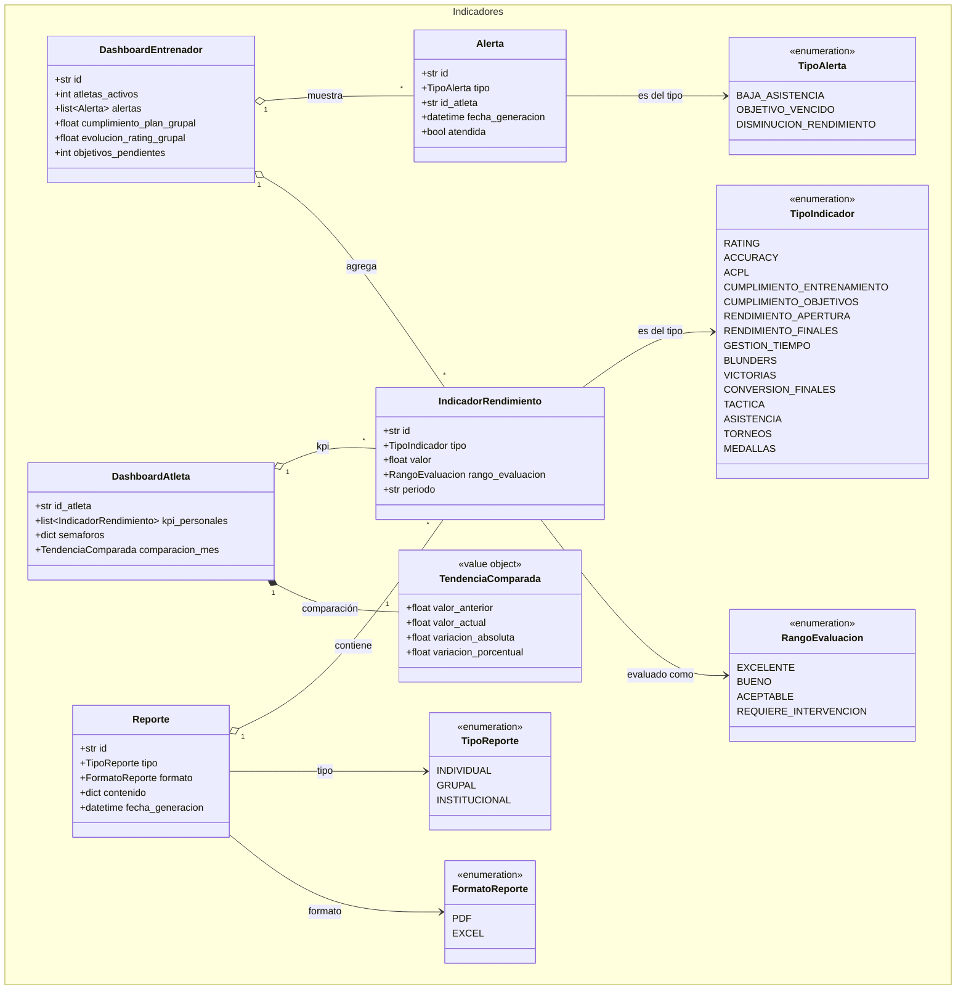

#### Reglas de Negocio Clave

- Los rangos de evaluación son **configurables** pero tienen valores por defecto definidos en el dominio.
- Las **alertas se generan automáticamente** cuando un indicador cae en "Requiere Intervención".
- En indicadores como ACPL y blunders, un **valor menor es mejor**.
- El **Informe Integral del Atleta** (RF-11.10) es una composición estricta de 8 secciones definidas en el dominio.

---

### 5.9 Evaluación del Entrenador — RF-10

**Responsabilidad:** evaluar el rendimiento del atleta tras cada torneo, mes, mesociclo o año.

#### Entidades

| Clase | Atributos principales |
|---|---|
| `EvaluacionAtleta` | `id_atleta`, `periodo`, `periodo_tipo`, `calificaciones` (8 indicadores del RF-10.2), `fortalezas`, `aspectos_mejorar`, `recomendaciones`, `promedio_calificaciones` |
| `PeriodoEvaluacion` | `TORNEO`, `MES`, `MESOCICLO`, `ANIO` |

#### Puertos

| Puerto | Tipo | Descripción |
|---|---|---|
| `RepositorioEvaluaciones` | Secundario | Persistencia de evaluaciones. |

#### Casos de Uso

| Caso de Uso | Actor | Descripción |
|---|---|---|
| `CrearEvaluacion` | Entrenador/Atleta | La del entrenador es **obligatoria** y cubre 8 indicadores; la del atleta es **opcional** y puede ser parcial. |
| `ActualizarEvaluacion` | Entrenador | Seguimiento entre ciclos. |
| `ConsultarEvaluacionesPorAtleta` | Entrenador/Atleta | Historial de evaluaciones. |

#### Diagrama de Clases

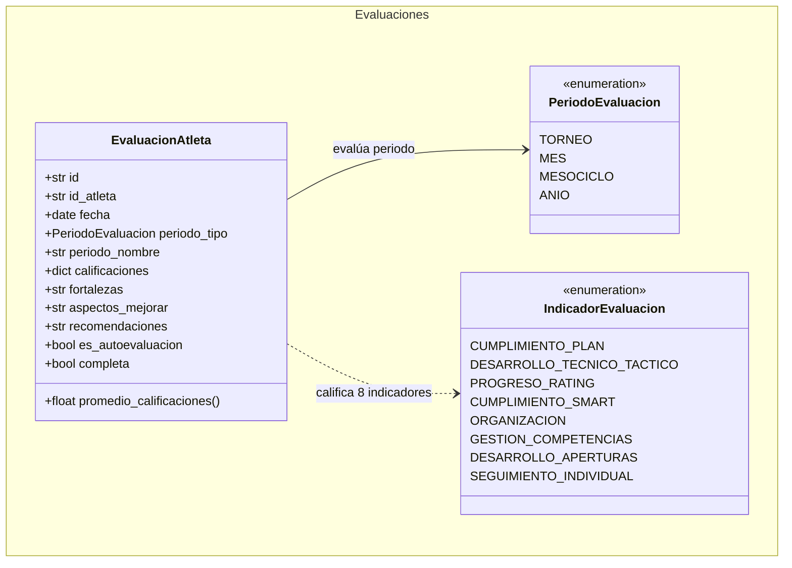

#### Reglas de Negocio Clave

- Calificación siempre entre **1 y 10**.
- La evaluación del entrenador es **obligatoria**; la autoevaluación del atleta es **opcional**.

---

### 5.10 Auditoría y Control de Cambios — RF-12

**Responsabilidad:** garantizar trazabilidad de todos los cambios críticos.

#### Entidades

| Clase | Atributos principales |
|---|---|
| `RegistroAuditoria` | `usuario`, `fecha_hora`, `entidad_afectada`, `campo_modificado`, `valor_anterior`, `valor_nuevo`, `tipo_operacion` |
| `TipoOperacion` | `CREAR`, `MODIFICAR`, `ELIMINAR` |

#### Puertos

| Puerto | Tipo | Descripción |
|---|---|---|
| `RepositorioAuditoria` | Secundario | Persistencia inmutable de auditoría. |

#### Casos de Uso

| Caso de Uso | Actor | Descripción |
|---|---|---|
| `RegistrarCambio` | Sistema | Crea registro inmutable de auditoría. |
| `ConsultarHistorialCambios` | Entrenador | Recupera trail de modificaciones (exige al menos un filtro). |
| `ValidarIntegridadDatos` | Sistema | Previene ratings incorrectos, resultados inválidos y eliminaciones no autorizadas. |

#### Diagrama de Clases

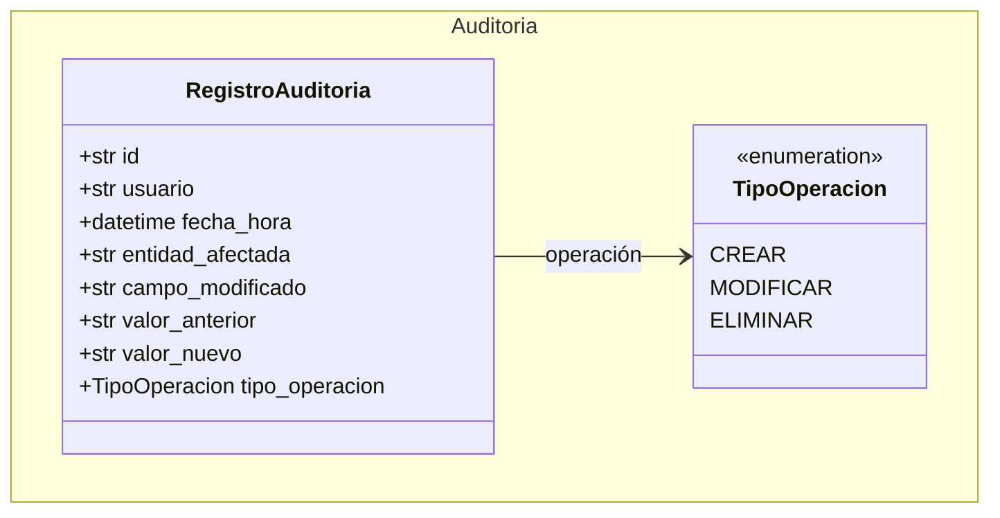

#### Reglas de Negocio Clave

- Toda modificación de datos sensibles genera **automáticamente** un registro de auditoría.
- Los **históricos no pueden eliminarse ni modificarse** una vez registrados.

---

## 6. Diagrama de Clases Global

Vista consolidada de las entidades principales y sus relaciones intermodulares.

```mermaid
classDiagram
    direction TB

    namespace Usuarios {
        class Usuario
        class Rol
    }

    namespace Atletas {
        class Atleta
        class Rating
        class PerfilHistorico
        class Categoria
    }

    namespace Entrenamientos {
        class PlanEntrenamientoSemanal
        class SesionEntrenamiento
        class EjecucionEntrenamiento
        class Asistencia
    }

    namespace Partidas {
        class Partida
        class AnalisisTecnico
        class EstadisticasFaseJuego
    }

    namespace Objetivos {
        class ObjetivoSmart
        class IndicadorAvance
    }

    namespace Aperturas {
        class AperturaRepertorio
        class EstadisticaApertura
    }

    namespace Patrones {
        class AnalisisPatrones
        class PatronDetectado
    }

    namespace Indicadores {
        class IndicadorRendimiento
        class DashboardEntrenador
        class DashboardAtleta
        class Alerta
        class Reporte
    }

    namespace Evaluaciones {
        class EvaluacionAtleta
    }

    namespace Auditoria {
        class RegistroAuditoria
    }

    Usuario "1" --> "*" Atleta : gestiona
    Atleta "1" *-- "1" Rating : tiene
    Atleta "1" *-- "*" PerfilHistorico : historial
    Atleta "1" o-- "*" Categoria : pertenece
    Atleta "1" --> "*" PlanEntrenamientoSemanal : entrena
    PlanEntrenamientoSemanal "1" *-- "*" SesionEntrenamiento : contiene
    SesionEntrenamiento "1" --> "1" EjecucionEntrenamiento : ejecutada
    SesionEntrenamiento "1" o-- "*" Asistencia : registra
    Atleta "1" --> "*" Partida : juega
    Partida "1" *-- "1" AnalisisTecnico : analizada
    Partida "1" *-- "1" EstadisticasFaseJuego : fases
    Atleta "1" --> "*" ObjetivoSmart : tiene
    ObjetivoSmart "1" *-- "1" IndicadorAvance : mide
    Atleta "1" --> "*" AperturaRepertorio : repertoire
    AperturaRepertorio "1" *-- "1" EstadisticaApertura : stats
    Atleta "1" --> "*" AnalisisPatrones : analizado en
    AnalisisPatrones "1" o-- "*" PatronDetectado : detecta
    Atleta "1" --> "*" IndicadorRendimiento : metricas
    DashboardEntrenador "1" o-- "*" IndicadorRendimiento : agrega
    DashboardEntrenador "1" o-- "*" Alerta : alerta
    DashboardAtleta "1" o-- "*" IndicadorRendimiento : kpi
    Atleta "1" --> "*" EvaluacionAtleta : evaluado
    Atleta "1" --> "*" RegistroAuditoria : auditado
    Reporte "1" o-- "*" IndicadorRendimiento : contiene
```

---

## 7. Dependencias entre Módulos

Los módulos se comunican sin acoplarse, siguiendo tres estrategias: referencias por ID, puertos de consulta cruzada y dependencias dirigidas hacia `comun/`.

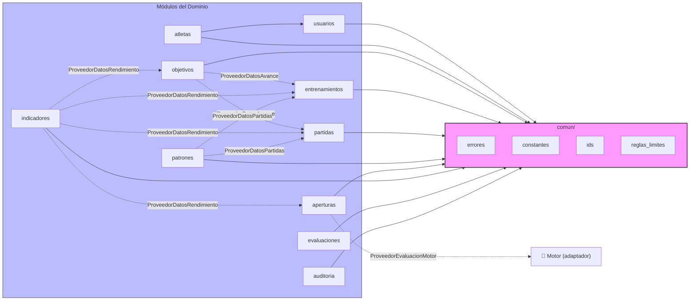

> **Leyenda:** Líneas sólidas = importación directa. Líneas punteadas = consulta cruzada mediante puertos (sin acoplamiento directo).

---

## 8. Flujo Típico de Uso

Un caso de uso se invoca igual desde cualquier adaptador (API web, script, test):

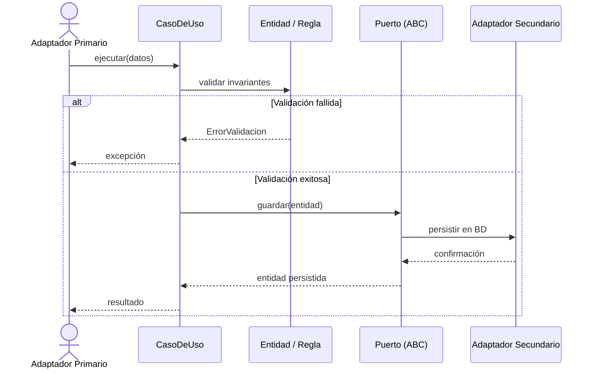

### Ejemplo en código

```python
from dominio.atletas.entidades import Atleta, Rating
from dominio.atletas.casos_de_uso import RegistrarAtleta

# 1. El adaptador provee una implementación concreta del puerto
class RepositorioEnMemoria(RepositorioAtletas):
    def __init__(self):
        self.datos = {}
    def guardar(self, atleta):
        self.datos[atleta.id] = atleta
        return atleta

repositorio = RepositorioEnMemoria()

# 2. Se instancia el caso de uso con sus dependencias
caso = RegistrarAtleta(
    repositorio_atletas=repositorio,
    repositorio_categorias=repo_categorias,
)

# 3. Se ejecuta el flujo de negocio
atleta = Atleta(
    id="atl_1",
    nombre="Ana Torres",
    fecha_nacimiento=date(2012, 5, 10),
    sexo="F",
    entrenadores_asignados=["ent_1"],
    rating_actual=Rating(clasicas=1650, rapidas=1600, blitz=1580,
                         chess_com=1700, lichess=1680),
)
atleta_registrado = caso.ejecutar(atleta)  # valida y persiste
```

Si se viola una regla (p. ej. faltan ratings obligatorios), se lanza `ErrorValidacion`.

---

## 9. Cómo Extender el Dominio

1. Crea la carpeta `dominio/<modulo>/` con un `__init__.py` vacío.
2. `entidades.py` — define las clases de datos con sus invariantes (validaciones y cálculos dentro de la entidad).
3. `puertos.py` — define los `ABC` que necesitará (repositorios, proveedores externos).
4. `casos_de_uso.py` — clases `@dataclass` con `ejecutar(...)`, inyectando puertos por constructor.
5. Si el módulo necesita datos de otro, define un **puerto de consulta cruzada** en lugar de importar repositorios ajenos.
6. Reutiliza `comun/errores.py`, `comun/ids.py` y las constantes/reglas compartidas.
7. Verifica que compila:

```bash
python -m compileall -q dominio
```

---

## 10. Validación

```bash
# Comprueba que todo el dominio compila
python -m compileall -q dominio

# Comprueba que los 14 módulos importan correctamente
python -c "import importlib; [importlib.import_module(m) for m in [
    'dominio.comun.errores',
    'dominio.comun.constantes',
    'dominio.comun.reglas_limites',
    'dominio.comun.ids',
    'dominio.usuarios',
    'dominio.atletas',
    'dominio.objetivos',
    'dominio.entrenamientos',
    'dominio.partidas',
    'dominio.aperturas',
    'dominio.indicadores',
    'dominio.patrones',
    'dominio.auditoria',
    'dominio.evaluaciones'
]]"
```

---

## 11. Adaptadores Pendientes

Según el plan de arquitectura, todo lo tecnológico se implementará como adaptadores **fuera** del dominio:

| Necesidad | Adaptador futuro | Puerto que implementa |
|---|---|---|
| Persistencia | SQLite / PostgreSQL + SQLAlchemy + Alembic | `Repositorio*` |
| Interfaz web | FastAPI (endpoints REST) | Casos de uso |
| Autenticación | JWT / OAuth / Sesiones | `ServicioHashContrasenas` |
| Exportación PDF/Excel | ReportLab / OpenPyXL | `ServicioGeneracionReportes` |
| Importación PGN | Parser de PGN | `ProveedorPGN` |
| Motor de ajedrez | Stockfish / python-chess | `ProveedorEvaluacionMotor` |
| APIs externas | Chess.com, Lichess, ChessBase | Adaptadores secundarios |

---

> **Nota de mantenimiento:** Este documento vive junto al código. Al modificar entidades, puertos o casos de uso, actualiza el diagrama y las tablas correspondientes para mantener la coherencia entre el modelo mental y la implementación.
