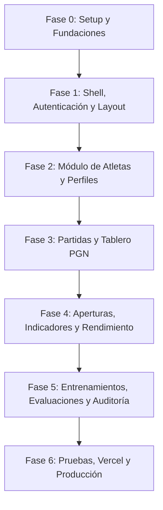

# Plan de Desarrollo — Frontend Caissa Analytic

Este plan organiza la construcción del frontend en fases iterativas e incrementales. Cada fase cuenta con objetivos claros, dependencias y criterios de éxito.

---

## 🗺️ Mapa de Fases

---

## 📋 Detalle de Fases

### 🔹 Fase 0: Inicialización y Fundaciones del Proyecto
* **Objetivo**: Configurar el entorno de desarrollo de Next.js, dependencias de diseño e integración base.
* **Tareas**:
  1. Inicializar Next.js con App Router, TypeScript y Tailwind CSS en el directorio `frontend/`.
  2. Inicializar **shadcn/ui** e instalar los primeros componentes base (`button`, `card`, `input`, `table`, `dialog`, `badge`, `dropdown-menu`, `tabs`).
  3. Configurar **Lucide React** para los iconos.
  4. Configurar el cliente HTTP centralizado (`src/lib/api-client.ts`) con soporte para token JWT y variables de entorno (`NEXT_PUBLIC_API_URL`).
  5. Configurar `next-themes` para soporte nativo de modo oscuro/claro.
* **Criterio de Entrega**: La aplicación compila limpiamente (`npm run dev`) y muestra una página base con modo oscuro funcional.

---

### 🔹 Fase 1: Shell de Navegación, Autenticación y Roles
* **Objetivo**: Crear la estructura principal de la aplicación y el flujo de inicio de sesión.
* **Tareas**:
  1. Diseñar la pantalla de inicio de sesión (`/login`) con validación de credenciales.
  2. Implementar almacenamiento de sesión (Token JWT en `localStorage` o Cookies HTTPOnly).
  3. Crear el layout del Dashboard (`Sidebar`, `Topbar`, `Breadcrumbs`, perfil de usuario activo).
  4. Implementar control de acceso según roles de usuario (Administrador, Entrenador, Atleta).
* **Criterio de Entrega**: El usuario puede autenticarse, ve la barra de navegación lateral con las secciones habilitadas según su rol y puede cerrar sesión.

---

### 🔹 Fase 2: Módulo de Atletas y Perfil Deportivo
* **Objetivo**: Permitir la gestión, búsqueda y visualización de atletas y sus datos federativos.
* **Tareas**:
  1. Vista de lista de atletas (`/atletas`): tabla con filtros (nombre, categoría, rango de ELO, estado activo/inactivo).
  2. Formulario para registrar o editar información del atleta.
  3. Vista de perfil del atleta (`/atletas/[id]`):
     * Ficha técnica del atleta (datos personales, club, federación, ELO FIDE/Nacional).
     * Resumen de rendimiento reciente.
     * Pestañas para acceder a sus partidas, aperturas y objetivos.
* **Criterio de Entrega**: CRUD o consulta completa de atletas consumiendo el backend de Python.

---

### 🔹 Fase 3: Visor de Partidas y Tablero Interactivo (Ajedrez)
* **Objetivo**: Permitir la carga, visualización y análisis de partidas en formato PGN.
* **Tareas**:
  1. Instalar y configurar `react-chessboard` y `chess.js`.
  2. Vista de listado de partidas (`/partidas`): filtros por atleta, color, resultado, fecha y apertura.
  3. Componente de subida de archivos PGN o pegado de texto PGN con validación inmediata.
  4. Visor interactivo de partida (`/partidas/[id]`):
     * Tablero interactivo con piezas SVG de alta calidad.
     * Lista de jugadas navegables con teclado (flechas izquierda/derecha) o clics.
     * Botones de voltear tablero, avanzar al inicio/final y pausar/reproducir automáticamente.
     * Metadatos de la partida (Torneo, Ronda, Jugador Blanco, Jugador Negro, Resultado).
* **Criterio de Entrega**: Se puede abrir una partida guardada en `caissa.db` y reproducirla paso a paso en el tablero digital.

---

### 🔹 Fase 4: Aperturas, Indicadores y Analítica Visual
* **Objetivo**: Proporcionar valor analítico profundo mediante gráficos estadísticos y repertorio.
* **Tareas**:
  1. Módulo de Aperturas (`/aperturas`):
     * Explorador de variantes (ECO Code, nombre de la apertura, jugadas).
     * Estadísticas de efectividad (% victorias con blancas vs negras).
  2. Módulo de Indicadores (`/indicadores`):
     * Gráfico de evolución de ELO a lo largo del tiempo (Recharts).
     * Métricas de precisión, errores graves (*blunders*) e imprecisiones detectadas.
     * Gráfico de radar con fortalezas tácticas vs posicionales.
* **Criterio de Entrega**: Gráficos interactivos y tableros estadísticos que reflejan los datos calculados en el dominio de Python.

---

### 🔹 Fase 5: Entrenamientos, Evaluaciones y Auditoría
* **Objetivo**: Completar los módulos operativos de los entrenadores y la trazabilidad del sistema.
* **Tareas**:
  1. Módulo de Entrenamientos (`/entrenamientos`): asignación de tareas tácticas, estudio de aperturas y seguimiento de cumplimiento.
  2. Módulo de Evaluaciones (`/evaluaciones`): fichas de evaluación periódica del entrenador hacia los atletas.
  3. Módulo de Auditoría (`/auditoria`): panel para administradores con historial de acciones críticas registradas por el backend.
  4. Generación y exportación de reportes (PDF / Excel / Impresión).
* **Criterio de Entrega**: Todos los módulos presentes en el backend cuentan con su interfaz visual correspondiente.

---

### 🔹 Fase 6: Optimización, Pruebas y Despliegue en Vercel
* **Objetivo**: Garantizar calidad, accesibilidad y despliegue continuo en Vercel.
* **Tareas**:
  1. Pruebas de integración de componentes y flujos de usuario (Vitest / Playwright).
  2. Optimización de imágenes, fuentes (Next/Font) y bundles para máxima puntuación en Lighthouse.
  3. Configuración de variables de entorno en el panel de **Vercel** (`NEXT_PUBLIC_API_URL`).
  4. Configuración del repositorio en Vercel para despliegue automático con cada `git push main`.
* **Criterio de Entrega**: Sitio web en producción en Vercel con certificado SSL y conectado a la API de Caissa Analytic.

